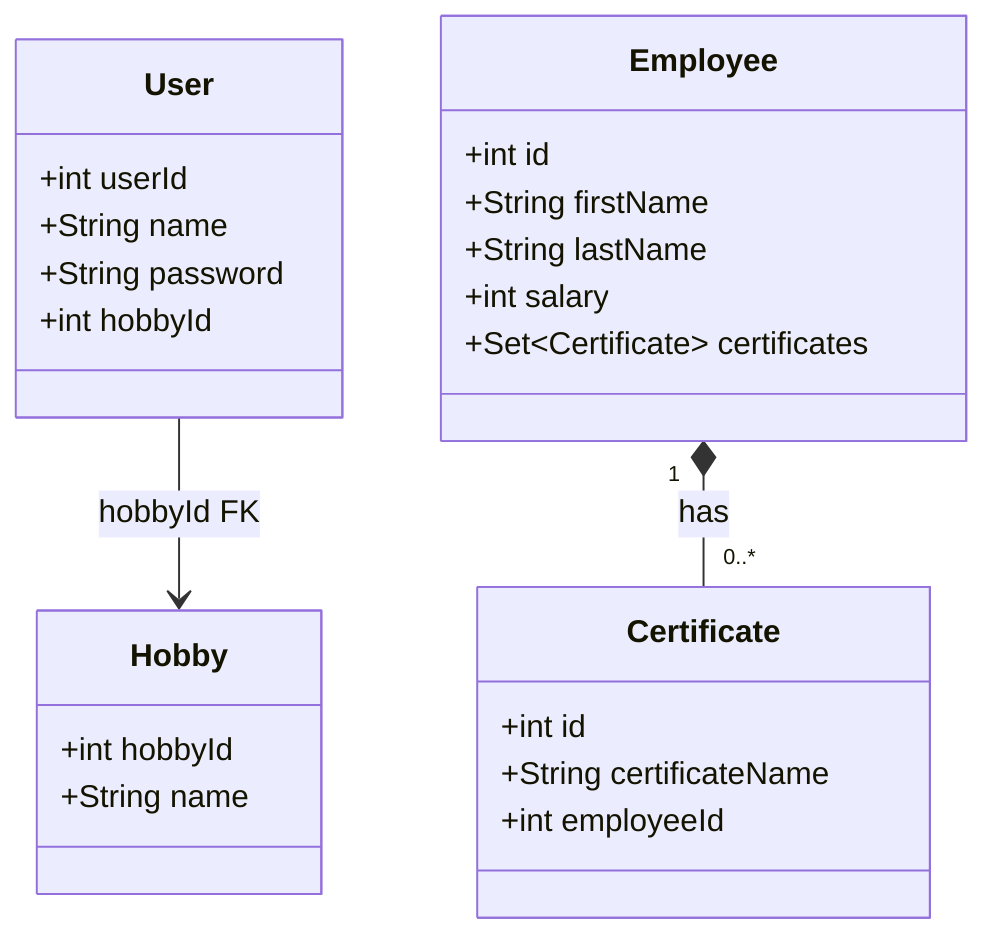
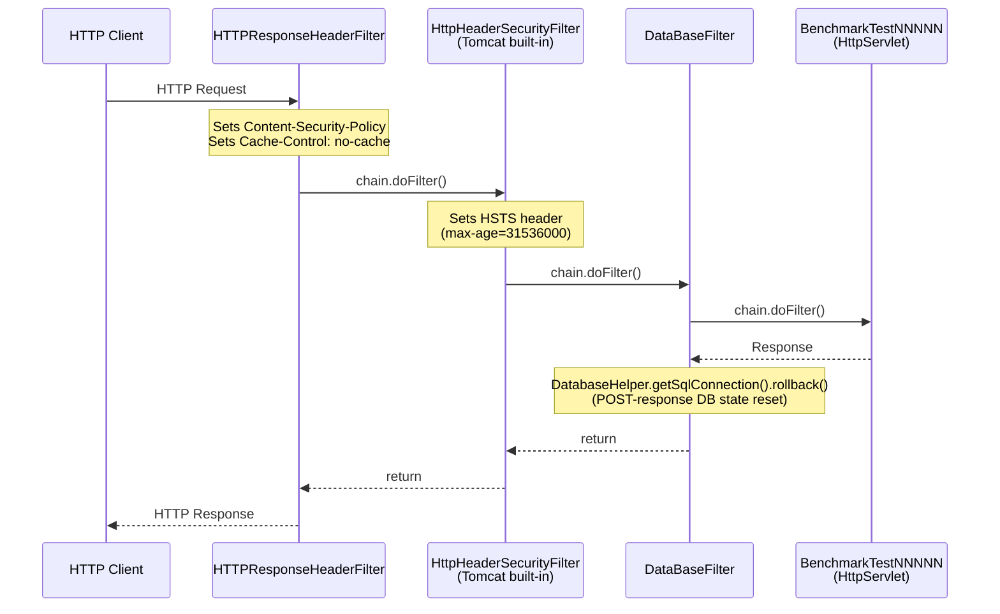
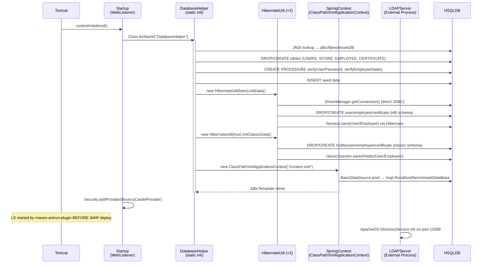
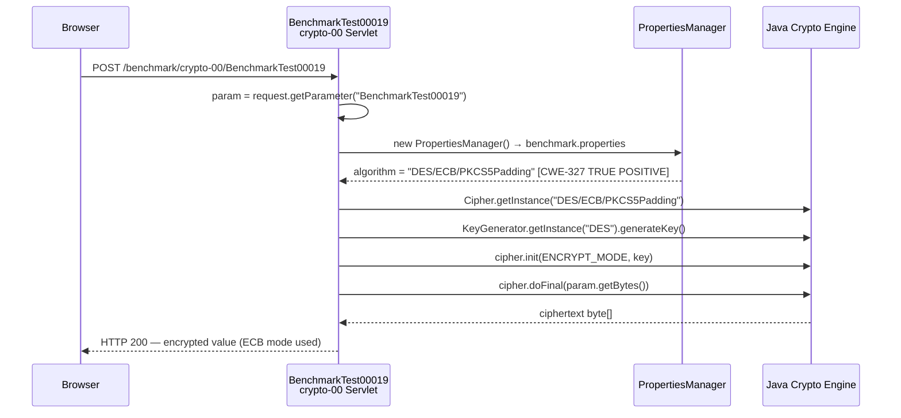
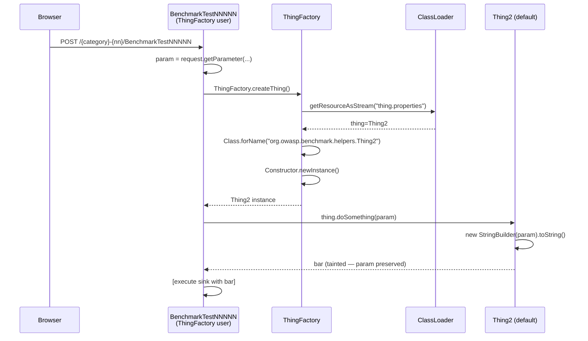

# OWASP Benchmark Java v1.2 — Architecture Map

> **Explore Subagent Report** · Source corpus: `target-repo/src/main/java/` · 2,765 Java source files examined  
> Generated by CIDE Orchestrator

---

## 1. Module Decomposition

The codebase compiles to a single WAR artifact (`benchmark.war`) with no internal modularity boundary. Logical packages form the structural decomposition:

```
org.owasp.benchmark                          [root namespace]
├── testcode/           2,740 classes         TEST SERVLET LAYER
├── helpers/               17 classes         INFRASTRUCTURE LAYER
│   ├── entities/           4 classes         JPA DOMAIN MODEL
│   └── filters/            2 classes         SERVLET FILTER LAYER
├── service/
│   └── pojo/               2 classes         REST TRANSFER OBJECTS
└── report/
    └── sonarqube/
        ├── (root)           1 class          REPORTING TOOL
        └── dto/             2 classes        REPORTING DTOs
```

### Module Responsibility Matrix

| Module | Responsibility | Change Frequency | External Dependencies |
|--------|---------------|------------------|-----------------------|
| `testcode` | 2,740 vulnerability test cases — sources, propagators, sinks | Never (generated) | `helpers`, `javax.servlet`, `javax.crypto`, `java.sql` |
| `helpers` | DB connections, LDAP, crypto utilities, lifecycle | Low | Spring, Hibernate, HSQLDB, ESAPI, BouncyCastle, ApacheDS |
| `helpers.entities` | JPA entity model for Hibernate paths | Low | Hibernate annotations |
| `helpers.filters` | Servlet filter chain: DB rollback, response headers | Low | `javax.servlet` |
| `service.pojo` | JAXB/XML POJOs for Spring REST endpoints | Low | JAXB |
| `report.sonarqube` | Standalone CLI to pull SonarQube results | On-demand | Jackson, commons-io |

---

## 2. Infrastructure Layer — Class Relationships

```mermaid
classDiagram
    direction LR

    class Startup {
        <<WebListener>>
        +contextInitialized(sce)
        +contextDestroyed(sce)
    }

    class DatabaseHelper {
        <<Utility>>
        -static Connection conn
        +static JdbcTemplate JDBCtemplate
        +static HibernateUtil hibernateUtil
        +static HibernateUtil hibernateUtilClassic
        +static boolean hideSQLErrors
        +static getSqlStatement() Statement
        +static getSqlConnection() Connection
        +static initDataBase()
        +static reset()
        +static printResults(...)
        +static outputUpdateComplete(...)
    }

    class HibernateUtil {
        -Session session
        -classic.Session classicSession
        -SessionFactory sessionFactory
        -Connection conn
        +HibernateUtil(boolean classic)
        +initData()
        +initClassicData()
        +checkData(sql)
        +getSession() Session
        +getClassicSession() classic.Session
        +destroySession()
    }

    class DataBaseServer {
        <<RestController>>
        +GET /resetdb
        +POST /testdb
        +GET /getall
        +static main(args)
    }

    class LDAPServer {
        -DirectoryService _directoryService
        -LdapServer _ldapServer
        -JdbmPartition _basePartition
        +init()
        +destroy()
        +addUsers(session)
    }

    class LDAPManager {
        -DirContext ctx
        +insert(LDAPPerson)
        -search(LDAPPerson)
        +getDirContext()
        +closeDirContext()
    }

    class LDAPPerson {
        -String name
        -String password
        -String address
        +getters/setters
    }

    class Utils {
        <<Utility>>
        +static TESTFILES_DIR String
        +static commonHeaders Set
        -static Cipher cipher
        +static getCipher() Cipher
        +static getOSCommandString(append) String
        +static getInsecureOSCommandString(cl) String
        +static printOSCommandResults(proc, response)
        +static encodeForHTML(param) String
        +static getSSLFactory() SSLConnectionSocketFactory
    }

    class PropertiesManager {
        -File file
        +PropertiesManager()
        +PropertiesManager(fileName)
        +getProperty(key, default) String
        +saveProperty(key, value)
    }

    class ThingFactory {
        <<Factory>>
        +static createThing() ThingInterface
    }

    class ThingInterface {
        <<interface>>
        +doSomething(i) String
    }

    class Thing1 {
        +doSomething(i) String
    }

    class Thing2 {
        +doSomething(i) String
    }

    class SeparateClassRequest {
        -HttpServletRequest request
        +getTheParameter(p) String
        +getTheCookie(c) String
        +getTheValue(p) String [SAFE - returns "bar"]
    }

    class ExpressionEvaluator {
        <<Stub - all null>>
        +static evaluateEL(expression, props) String
        +evaluate(...) Object
        +parseExpression(...) Expression
    }

    class DataBaseFilter {
        <<Filter url="/*">>
        +doFilter(req, resp, chain)
    }

    class HTTPResponseHeaderFilter {
        <<Filter url="/*">>
        +doFilter(req, resp, chain)
    }

    Startup ..> DatabaseHelper : Class.forName() triggers static init
    Startup ..> BouncyCastleProvider : Security.addProvider()
    DatabaseHelper *-- HibernateUtil : owns two instances
    DatabaseHelper ..> SpringJdbcTemplate : wires via ClassPathXmlApplicationContext
    LDAPManager --> LDAPPerson : uses
    LDAPManager ..> ApacheDS : JNDI ldap://localhost:10389
    LDAPServer ..> ApacheDS : embeds DirectoryService
    ThingFactory ..> ThingInterface : reflection + thing.properties
    ThingInterface <|.. Thing1
    ThingInterface <|.. Thing2
    DataBaseFilter ..> DatabaseHelper : getSqlConnection().rollback()
    DataBaseServer ..> DatabaseHelper : getSqlConnection()
```

---

## 3. JPA Entity Model



> **Note:** These entities map to two separate HSQLDB schema sets — one bootstrapped via `HibernateUtil.initData()` (modern Hibernate API) and one via `HibernateUtil.initClassicData()` (Hibernate 2 classic API). Both schema sets are recreated at every application startup.

---

## 4. Servlet Entry Points

### 4.1 URL Namespace Map

Every test servlet is registered via `@WebServlet` annotation. The URL pattern is:

```
/{category}-{folder-index}/BenchmarkTest{NNNNN}
```

| Category Prefix | Folders | CWE | Servlet Count |
|----------------|---------|-----|--------------|
| `/sqli-{00-06}/` | 7 | CWE-89 | 504 |
| `/xss-{00-05}/` | 6 | CWE-79 | 455 |
| `/weakrand-{00-06}/` | 7 | CWE-330 | 493 |
| `/pathtraver-{00-03}/` | 4 | CWE-22 | 268 |
| `/cmdi-{00-03}/` | 4 | CWE-78 | 251 |
| `/crypto-{00-03}/` | 4 | CWE-327 | 246 |
| `/hash-{00-02}/` | 3 | CWE-328 | 236 |
| `/trustbound-{00-01}/` | 2 | CWE-501 | 126 |
| `/securecookie-00/` | 1 | CWE-614 | 67 |
| `/ldapi-00/` | 1 | CWE-90 | 59 |
| `/xpathi-00/` | 1 | CWE-643 | 35 |
| **Total** | **40** | | **2,740** |

### 4.2 Spring REST Endpoints (via DispatcherServlet `→ /service/*`)

| Method | Path | Class | Status |
|--------|------|-------|--------|
| `GET` | `/resetdb` | `DataBaseServer` | Stub — returns "Not Implemented" |
| `POST` | `/testdb` | `DataBaseServer` | Stub — returns "Not Implemented" |
| `GET` | `/getall` | `DataBaseServer` | Live — executes `SELECT * from USERS` |

---

## 5. Input Source Taxonomy

Across 2,740 test servlets, tainted input originates from six source classes:

| Source API | Call Count | Description |
|-----------|-----------|-------------|
| `request.getParameter(name)` | 1,312 | HTTP POST/GET form parameter |
| `request.getHeader(name)` | 1,052 | Custom or standard HTTP header (Referer, etc.) |
| `request.getCookies()` | 709 | Named HTTP cookie value |
| `request.getQueryString()` | 590 | Raw query string |
| `request.getSession()` | 1,112 | Session attribute (trustbound) |
| `SeparateClassRequest.getTheParameter/getTheCookie` | 1,020 | Delegate wrapper (tainted) |
| `ThingFactory.createThing()` | 374 | Reflection-instantiated propagator |

---

## 6. Taint Propagation Patterns

The 919 servlets containing a private `doSomething()` helper demonstrate the benchmark's **taint obfuscation corpus** — varying the complexity of data-flow paths between source and sink to exercise SAST inter-procedural analysis. Observed patterns:

| Pattern | Example | Taint Preserved? |
|---------|---------|-----------------|
| **Direct pass-through** | `bar = param` | ✅ Yes |
| **StringBuilder wrapping** | `new StringBuilder(param).toString()` | ✅ Yes |
| **Collection round-trip** | `map.put("k", param); bar = map.get("k")` | ✅ Yes |
| **List insert/remove** | `list.add(param); list.remove(0); bar = list.get(1)` | ✅ Yes (index shift) |
| **SeparateClassRequest.getTheValue()** | returns literal `"bar"` | ❌ No — safe source |
| **Arithmetic gating** | `if ((500/42)+196 > 200) bar = param` | ✅ Yes (always true) |

---

## 7. Sink API Distribution

| Sink API | Call Count | Category |
|----------|-----------|----------|
| `response.getWriter().print/println/format` | 7,207 | XSS output |
| `Cipher.getInstance(algorithm)` | 1,122 | Crypto |
| `MessageDigest.getInstance(algorithm)` | 743 | Hash |
| `ProcessBuilder(cmds)` | 189 | OS Command |
| `Statement.executeUpdate(sql)` | 70 | SQL Injection |
| `Statement.executeQuery()` | 70 | SQL Injection |
| `CallableStatement prepareCall(sql)` | 57 | SQL Injection |

---

## 8. Filter Chain

The `web.xml` declares a three-filter chain applied globally to `/*`:



> **Design Note:** `DataBaseFilter` calls `rollback()` **after** the response has already been written and returned to the client. This is a post-processing reset to restore DB state for the next test run — it does not affect the response the client received.

---

## 9. Application Startup Sequence



---

## 10. Request Flow — Canonical SQL Injection Path

```mermaid
sequenceDiagram
    participant Browser as Browser / Crawler
    participant F1 as HTTPResponseHeaderFilter
    participant F3 as DataBaseFilter
    participant BT as BenchmarkTest00018<br/>sqli-00 Servlet
    participant DH as DatabaseHelper
    participant HSQL as HSQLDB (in-process)

    Browser->>F1: POST /benchmark/sqli-00/BenchmarkTest00018<br/>Header: BenchmarkTest00018: '; DROP TABLE users--
    F1->>F3: chain.doFilter() + sets CSP/Cache-Control
    F3->>BT: chain.doFilter()
    BT->>BT: param = request.getHeaders("BenchmarkTest00018").nextElement()
    BT->>BT: param = URLDecoder.decode(param, "UTF-8")
    BT->>BT: sql = "INSERT INTO users ... VALUES ('foo','" + param + "')"
    BT->>DH: getSqlStatement()
    DH-->>BT: Statement (shared static Connection)
    BT->>HSQL: statement.executeUpdate(sql) ← INJECTION POINT
    HSQL-->>BT: count
    BT->>DH: outputUpdateComplete(sql, response)
    DH->>DH: ESAPI.encoder().encodeForHTML(sql)
    DH-->>Browser: HTTP 200 HTML response
    BT-->>F3: return
    F3->>HSQL: getSqlConnection().rollback() ← DB reset
```

---

## 11. Request Flow — Crypto Test Case (CWE-327)



---

## 12. Request Flow — Taint via ThingFactory (Indirect Path)



---

## 13. Static Resource Layer

Each test servlet has a corresponding HTML form at:

```
/benchmark/{category}-{nn}/BenchmarkTest{NNNNN}.html
```

The HTML forms use jQuery + `js.cookie.js` + custom `testsuiteutils.js` to either:
- POST form data as an HTTP parameter
- Set a cookie value then POST
- Send an AJAX request with a custom header

Total static HTML forms: **2,753** (2,740 test forms + 13 category index pages).

---

## 14. Configuration Files

| File | Location | Purpose |
|------|----------|---------|
| `web.xml` | `src/config/web.xml` | Servlet 3.1 deployment descriptor — filters, Spring DispatcherServlet, JNDI resource |
| `context.xml` (Tomcat) | `src/main/webapp/META-INF/context.xml` | JNDI ResourceLink, SameSite cookie policy |
| `context.xml` (Spring) | `src/main/resources/context.xml` | Spring bean definitions — `BasicDataSource`, `JdbcTemplate` |
| `benchmark-servlet.xml` | `src/main/webapp/WEB-INF/` | Spring MVC config — JNDI lookup, component-scan, annotation-driven |
| `hibernate.cfg.xml` | `src/main/resources/` | Hibernate connection + mapping registration |
| `benchmark.properties` | `src/main/resources/` | `cryptoAlg1=DES/ECB/PKCS5Padding`, `hashAlg1=MD5`, test count config |
| `thing.properties` | `src/main/resources/` | `thing=Thing2` — controls ThingFactory reflection target |
| `ESAPI.properties` | `src/main/resources/` | ESAPI encoder configuration |
| `server.xml` / `context.xml` | `src/config/local/` and `/remote/` | Cargo Tomcat HTTPS connector configs |
