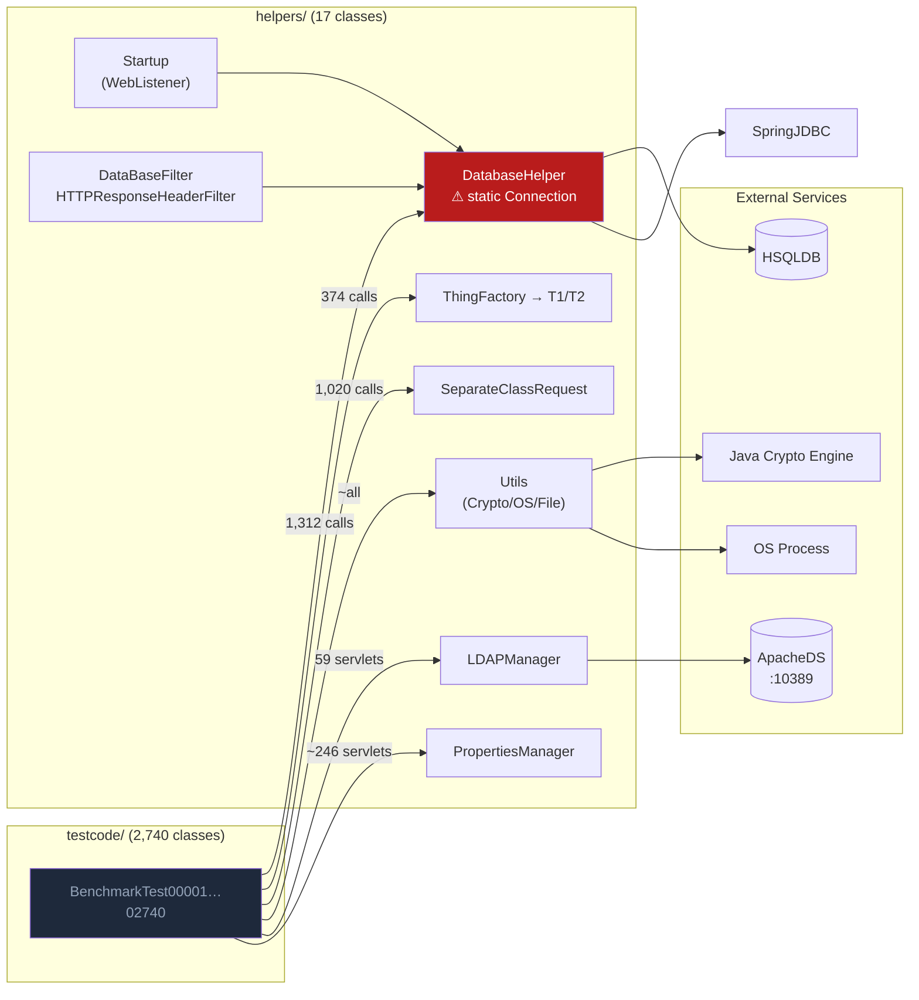

# Software Architecture Report — OWASP Benchmark Java v1.2

**Classification:** Internal Technical Reference  
**Prepared by:** CIDE Explore Subagent + Synthesis Engine  
**Source Corpus:** `target-repo/src/main/java/` — 2,765 Java files  
**Date:** 2025

---

## 1. Executive Summary

The OWASP Benchmark for Java v1.2 is a **deliberately vulnerable Java EE monolith** deployed as a single WAR artifact on Apache Tomcat. It comprises **2,740 independently routed `HttpServlet` test cases** across 11 vulnerability categories, each representing a precisely calibrated exploit-or-safe test vector for evaluating SAST, DAST, and IAST tool accuracy.

### Structural Profile at a Glance

| Metric | Value |
|--------|-------|
| Total Java source files | 2,765 |
| Test servlet classes | 2,740 |
| Infrastructure classes | 17 |
| Static HTML forms | 2,753 |
| Vulnerability categories | 11 |
| True positive (exploitable) cases | 1,515 (55%) |
| True negative (safe) cases | 1,225 (45%) |
| Lines of code (infrastructure only) | ~2,886 |
| Input source types | 6 distinct |
| Taint propagation patterns | 6 distinct |
| Persistence mechanisms | 3 parallel (JDBC / Spring JdbcTemplate / Hibernate) |
| Filter layers | 3 (CSP, HSTS, DB Rollback) |
| Deployment runtime | Apache Tomcat 9/10, HTTPS port 8443 |

### Key Structural Risks

1. **Non-thread-safe shared JDBC `Connection`** in `DatabaseHelper` — viable for sequential crawling only
2. **Three parallel persistence layers** initialized unconditionally at startup — contradicts original latency-isolation design intent
3. **Dual Hibernate API instances** (modern + classic) with overlapping HSQLDB schema DDL executed at startup
4. **Hardcoded SonarQube credentials** in `SonarReport.java` (committed to SCM)
5. **`ExpressionEvaluator`** is a no-op stub with all methods returning `null` — unused dead code
6. **`DataBaseServer.main()`** is a required-but-empty method purely to satisfy an Ant build task

---

## 2. Architectural Pattern Classification

### 2.1 Primary Pattern: Servlet-per-Test-Case Monolith

The dominant pattern is a **Flat Servlet Array**: 2,740 `HttpServlet` subclasses each handling one URL, with no shared state or inter-servlet communication. This pattern is structurally analogous to the **Page Controller** pattern (Fowler, PoEAA) applied to security testing:

```
Client → Filter Chain → BenchmarkTestNNNNN → DatabaseHelper/Utils/LDAPManager → HSQLDB/ApacheDS
```

Each servlet is a **self-contained source-propagation-sink pipeline** of 50–120 lines. The pipeline is deterministic within a single request:

```
[Input Source] → [Optional Propagator/Obfuscator] → [Sink API]
```

### 2.2 Secondary Pattern: Service Locator via Static Helpers

`DatabaseHelper`, `Utils`, `LDAPManager`, and `PropertiesManager` act as **Service Locators** — globally accessible static facades over infrastructure services. This pattern:
- ✅ Eliminates dependency injection complexity in 2,740 generated servlets
- ❌ Creates hidden global state (the static `Connection conn` field)
- ❌ Makes test isolation impossible at the class level — all tests share the same database connection object

### 2.3 Tertiary Pattern: Factory Method for Taint Obfuscation

`ThingFactory` uses **reflection-based Factory Method** to create `ThingInterface` implementations at runtime, controlled by `thing.properties`. Used in 374 test cases to introduce inter-class taint propagation that exercises SAST call-graph analysis.

### 2.4 Ancillary Pattern: Spring MVC DispatcherServlet for REST

A minimal Spring MVC layer (`DataBaseServer`, `benchmark-servlet.xml`) handles `/service/*` paths. This is architecturally isolated from the test servlet layer and currently has stub implementations — it serves no active testing purpose in v1.2.

---

## 3. Structural Coupling Analysis

### 3.1 Coupling Matrix (Infrastructure → Dependents)



**Efferent coupling of `DatabaseHelper`:** 8 distinct outbound dependencies (JNDI, JDBC, Spring, Hibernate ×2, ESAPI, HSQLDB direct, XMLMessage DTO). This is the highest-coupled class in the system.

### 3.2 Fan-in (Afferent Coupling) Leaders

| Class | Approximate Inbound References | Risk |
|-------|-------------------------------|------|
| `DatabaseHelper` | ~1,312 servlets + 2 filters + `DataBaseServer` + `Startup` | **CRITICAL** — single point of JDBC failure |
| `Utils` | ~2,400 servlets (crypto, OS, file paths) | HIGH |
| `PropertiesManager` | ~246 servlets (crypto algorithm lookup) | MEDIUM |
| `SeparateClassRequest` | 1,020 servlets | MEDIUM |
| `ThingFactory` | 374 servlets | MEDIUM |
| `LDAPManager` | ~59 servlets | LOW |

### 3.3 Cohesion Assessment

| Module | Cohesion Type | Assessment |
|--------|--------------|------------|
| `testcode/*` | **Coincidental** (by generation) | Individual classes are highly cohesive single-responsibility units; the package as a whole is a flat array with no internal relationships |
| `helpers/DatabaseHelper` | **Sequential + Communicational** | All methods operate on the same JDBC state — high internal cohesion, but the class does too much (DDL, DML, response rendering, Hibernate, Spring bootstrap) |
| `helpers/Utils` | **Coincidental** | Crypto, OS commands, file I/O, SSL factory, HTML encoding utility — unrelated concerns bundled by convenience |
| `helpers/filters/` | **Functional** | Each filter has a single, well-defined cross-cutting concern |
| `helpers/entities/` | **Functional** | Each entity is a pure domain object |
| `service/pojo/` | **Functional** | Pure data transfer objects |

---

## 4. Cyclomatic Complexity Hotspots

Cyclomatic complexity proxied by counting branching keywords (`if`, `for`, `while`, `switch`, `catch`) per infrastructure class:

| Class | Branch Count | Estimated CC | Assessment |
|-------|-------------|-------------|------------|
| [`Utils.java`](target-repo/src/main/java/org/owasp/benchmark/helpers/Utils.java) | 46 | ~18–22 | **HIGH** — 11 methods of varied concern; `getCipher()`, `getSSLFactory()`, file permission logic all interleaved |
| [`DatabaseHelper.java`](target-repo/src/main/java/org/owasp/benchmark/helpers/DatabaseHelper.java) | 36 | ~14–18 | **HIGH** — DDL execution, Hibernate wiring, Spring context bootstrap, 6 overloaded `printResults()` variants |
| [`HibernateUtil.java`](target-repo/src/main/java/org/owasp/benchmark/helpers/HibernateUtil.java) | 23 | ~10–13 | **MEDIUM** — Two parallel code paths (modern vs. classic Hibernate API) nearly double the cognitive load |
| [`LDAPServer.java`](target-repo/src/main/java/org/owasp/benchmark/helpers/LDAPServer.java) | 18 | ~9–11 | MEDIUM |
| [`LDAPManager.java`](target-repo/src/main/java/org/owasp/benchmark/helpers/LDAPManager.java) | 11 | ~6–8 | LOW-MEDIUM |
| [`PropertiesManager.java`](target-repo/src/main/java/org/owasp/benchmark/helpers/PropertiesManager.java) | 6 | ~4–6 | LOW |

**Test code pattern:** All 2,740 test servlets follow a stereotyped structure. The 919 with a `doSomething()` helper typically have CC of 3–6; the remaining 1,821 without it have CC of 2–3. Maximum observed in any single test file: ~8.

---

## 5. Data-Access Layer Deep Dive

Three distinct persistence mechanisms co-exist and are **all initialized at startup regardless of which test cases execute**:

### 5.1 Mechanism 1: Raw JDBC (Primary)

```
Startup → DatabaseHelper static init
       → JNDI lookup "java:comp/env/jdbc/BenchmarkDB"
       → commons-dbcp BasicDataSource (hsql://localhost/benchmarkDataBase)
       → static Connection conn (NON-THREAD-SAFE)
       → Statement / PreparedStatement / CallableStatement
```

Used by the majority of `sqli-*` test cases. The shared static `Connection` is the most significant structural defect for any concurrent usage.

### 5.2 Mechanism 2: Spring JdbcTemplate

```
Startup → DatabaseHelper static init
       → new ClassPathXmlApplicationContext("/context.xml")
       → BasicDataSource (same HSQLDB instance, different pool)
       → JdbcTemplate.query() / update()
       → stored in DatabaseHelper.JDBCtemplate (static field)
```

Used by a subset of test cases that call `DatabaseHelper.JDBCtemplate`. Operates through a second connection pool against the same embedded HSQLDB.

### 5.3 Mechanism 3: Hibernate ORM (Two Instances)

```
Startup → DatabaseHelper static init
       → HibernateUtil(false) → SessionFactory (modern API)
                              → Session → session.save(User/Employee)
       → HibernateUtil(true)  → SessionFactory (classic API)
                              → classic.Session → classicSession.save(Hobby/User)
```

Both Hibernate instances open their own JDBC `Connection` via `DriverManager.getConnection("jdbc:hsqldb:benchmarkDataBase")` — a third connection path to the same HSQLDB. The dual-API design (Hibernate modern + Hibernate 2 classic) is explicitly flagged in a TODO comment as a potential cleanup target for v1.3.

### 5.4 HSQLDB Schema Collision Risk

All three mechanisms operate on overlapping table names in the same HSQLDB instance:

| Table | Created By | Dropped By |
|-------|-----------|-----------|
| `USERS` | `DatabaseHelper.initDataBase()` | Same |
| `EMPLOYEE` | `DatabaseHelper.initDataBase()` | Same |
| `CERTIFICATE` | `DatabaseHelper.initDataBase()` | Same |
| `EMPLOYEE` | `HibernateUtil.initData()` | Same (DROP IF EXISTS) |
| `CERTIFICATE` | `HibernateUtil.initData()` | Same (DROP IF EXISTS) |
| `USER` | `HibernateUtil.initData()` | Same |
| `USER` | `HibernateUtil.initClassicData()` | Same (DROP IF EXISTS) |
| `HOBBY` | `HibernateUtil.initClassicData()` | Same |

The startup sequence in `DatabaseHelper` runs these three schema initializations sequentially. If ordering changes, DDL conflicts will occur silently.

---

## 6. Servlet Generation Architecture

The 2,740 test classes are **generated code**, not hand-authored. The generation logic (external to this repository) produces servlets following a strict structural grammar:

```
BenchmarkTestNNNNN
├── @WebServlet("/{category}-{nn}/BenchmarkTestNNNNN")
├── doGet()  →  either: sets cookie + serves HTML form
│                    or: delegates to doPost()
└── doPost()
    ├── [Source extraction block]    ← one of 6 source patterns
    ├── [optional doSomething()]     ← one of 6 propagation patterns
    └── [Sink execution block]       ← one of 12 sink patterns
```

**Category-to-folder assignment** is strictly bounded at 80 tests per folder (enforced by `benchmark.properties: testCases.per.folder=80`), with the last folder potentially holding fewer (e.g., `hash-02` has 76, `xss-05` has 55).

---

## 7. Modernization Roadmap

The following items are ordered by impact-to-effort ratio. None of these apply to the generated `testcode/` package — only to the infrastructure layer.

### Priority 1 — Critical Structural Fixes (High Impact, Low Effort)

| Item | Problem | Recommended Change | Effort |
|------|---------|-------------------|--------|
| **M-01** | `DatabaseHelper.conn` is a non-thread-safe static | Replace with connection-per-request using `DataSource.getConnection()` wrapped in try-with-resources | 2 days |
| **M-02** | `Utils.getSSLFactory()` uses TLSv1 + `NoopHostnameVerifier` | Update to `TLSv1.2`/`TLSv1.3`; use `DefaultHostnameVerifier` | 30 min |
| **M-03** | `SonarReport.java` hardcodes `SONAR_PASSWORD = "P4ssword!!!!"` | Externalize to env var or `~/.benchmark/sonar.properties` | 1 hour |
| **M-04** | `LDAPManager` swallows `NamingException` in constructor | Propagate exception; null `ctx` guard in every method | 1 hour |

### Priority 2 — Dependency Modernization (Medium Impact, Low-Medium Effort)

| Item | Current | Target | Risk |
|------|---------|--------|------|
| **M-05** | `commons-dbcp:1.4` (EOL 2013) | `commons-dbcp2:2.12.0` or HikariCP 5.x | Low — API compatible |
| **M-06** | `commons-lang:2.6` (EOL 2011) | `commons-lang3:3.17.0` | Medium — package rename |
| **M-07** | `jersey-servlet:1.19.4` (EOL 2014, JAX-RS 1.x) | `jersey-container-servlet:3.1.x` (JAX-RS 3.0) | Medium |
| **M-08** | `bcprov-jdk15on:1.70` (CVE-2023-33201) | `bcprov-jdk18on:1.77+` | Low |
| **M-09** | `jaxb-api:2.3.1` (`javax.xml.bind`) | `jakarta.xml.bind-api:4.0.0` | Medium — namespace change |

### Priority 3 — Architectural Debt Reduction (Medium Impact, High Effort)

| Item | Problem | Recommended Approach | Effort |
|------|---------|---------------------|--------|
| **M-10** | `DatabaseHelper` does too much (DDL, DML, response rendering, framework wiring) | Split into `SchemaInitializer`, `QueryHelper`, `ResponseWriter` | 1 week |
| **M-11** | `Utils` is a grab-bag of unrelated utilities | Split into `CryptoUtils`, `OSCommandUtils`, `FileUtils`, `SslUtils` | 3 days |
| **M-12** | Dual Hibernate API instances (`modern` + `classic`) doubles startup cost and schema risk | Remove `classic` session if Hibernate 2 test cases are no longer needed (per TODO in `HibernateUtil`) | 2 days |
| **M-13** | Spring `ClassPathXmlApplicationContext` uses Spring 2.0 XML schema URLs | Upgrade to Spring 5+ schema URIs; migrate to Java config `@Configuration` | 1 day |
| **M-14** | `ExpressionEvaluator` is a dead-code stub with all null returns | Remove the class entirely | 15 min |
| **M-15** | `DataBaseServer` REST stubs `/resetdb` and `/testdb` return "Not Implemented" | Either implement or remove; document intent | 1 day |

### Priority 4 — Platform Modernization (Low Impact for Benchmark, High Architectural Value)

| Item | Current | Target |
|------|---------|--------|
| **M-16** | Java EE 8 (`javax.*` namespace) | Jakarta EE 10 (`jakarta.*` namespace) |
| **M-17** | Hibernate ORM 5.x | Hibernate ORM 6.x (Jakarta Persistence 3.1) |
| **M-18** | Spring Framework 5.x | Spring Framework 6.x (Jakarta EE 9+) |
| **M-19** | Servlet 3.1 (`web-app_3_1.xsd`) | Servlet 6.0 |
| **M-20** | Java 8 bytecode target | Java 17 LTS (minimum) or Java 21 LTS |

> **⚠ Migration Warning:** Items M-16 through M-20 form a tightly coupled upgrade chain. The `javax` → `jakarta` namespace migration (M-16) must be completed first and affects all subsequent upgrades. This migration also invalidates approximately 30% of the generated test code's import statements and would require regenerating the test corpus.

---

## 8. Structural Debt Summary

```
STRUCTURAL DEBT HEATMAP
═══════════════════════════════════════════════════════════════════

Component               Volume  Coupling  Cohesion  Complexity  Debt
─────────────────────────────────────────────────────────────────────
DatabaseHelper           375L    ████████  ███░░     ████████    HIGH
Utils                    452L    ████████  ██░░░     ███████░    HIGH
HibernateUtil            328L    ████░░░   ████░     █████░░     MED-HIGH
LDAPServer               375L    ███░░░    ████░     ████░░      MEDIUM
LDAPManager              146L    ██░░░     █████     ███░░       MEDIUM
PropertiesManager        102L    ██░░░     █████     ██░░░       LOW
filters/*                121L    ██░░░     █████     ██░░░       LOW
testcode/* (each)        ~75L    ███░░     █████     ██░░░       LOW (by design)
─────────────────────────────────────────────────────────────────────
Legend: █ = filled (worse) · ░ = empty (better)
```

The infrastructure layer (~2,886 lines, 17 classes) carries disproportionate structural debt relative to its size. The `testcode/` layer (2,740 classes, ~205,000 lines) is high volume but low individual complexity by design — it is generated code and should never be hand-modified.
